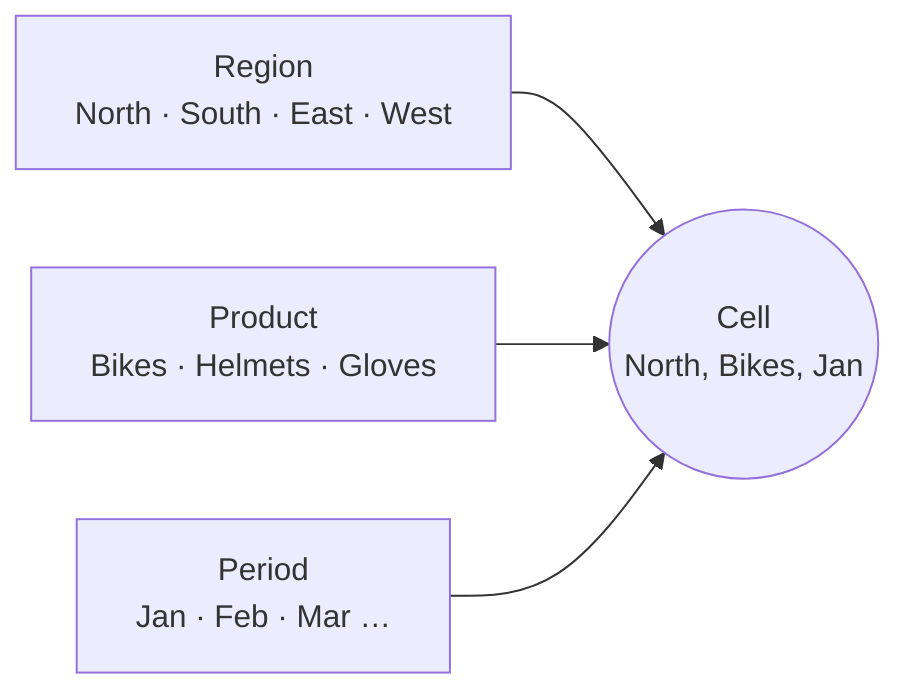

# Cubes and dimensions

## Dimensions

A **dimension** is a list of items that describe one aspect of your data. Each item is called an **element**.

In the sample model:

- the **Region** dimension has the elements North, South, East, West and Total Region
- the **Period** dimension has the elements Jan to Dec, Q1 to Q4 and Full Year

Dimensions are shared: the same Period dimension can be used by a Sales cube, a Headcount cube and an Expenses cube. Changing the dimension changes it for every cube that uses it.

## Cubes

A **cube** is built from an ordered list of dimensions. It can hold a value for every combination of one element from each dimension.

The **Sales** cube is built from six dimensions:

```text
Version × Year × Period × Region × Product × Sales Measure
```

Each dimension answers one question about a number in the cube:

| Dimension | Answers the question | What it represents |
| --- | --- | --- |
| **Version** | Which scenario? | Whether a number is what really happened (**Actual**), what was planned at the start of the year (**Budget**), or the latest estimate of how the year will end (**Forecast**). Keeping versions side by side lets you compare plan with reality. |
| **Year** | Which financial year? | The year the number belongs to. Keeping years separate from months lets you compare the same month across years, such as Jan 2025 with Jan 2026. |
| **Period** | When in the year? | The months of the year, with quarters (Q1 to Q4) and Full Year as totals of those months. |
| **Region** | Where? | The sales regions the business is split into, with Total Region adding them up to the whole company. |
| **Product** | What was sold? | The products the business sells, with Total Product adding them up. A real model might group products into categories first. |
| **Sales Measure** | What is being measured? | The kind of number: how many items were sold (**Units**), what each one sold for (**Price**), and the money taken (**Revenue**). |

The first five dimensions describe the *context* of a number: which scenario, when, where and what. The last dimension, Sales Measure, says *what kind of number* it is. Most TM1 cubes follow this pattern.

A TM1 cube needs at least two dimensions and can have up to 256, although most real cubes have far fewer.

!!! tip "Measures are just another dimension"
    In TM1, the things you measure, such as Units, Price and Revenue, are elements of an ordinary dimension. By convention the measures dimension is the last one in a cube.

## Cells

A **cell** is one point in a cube. You identify a cell by naming one element from each dimension, in the cube's dimension order. This list of elements is the cell's **address**, sometimes called a **tuple**.

```text
Sales: Actual, 2026, Jan, North, Bikes, Units
```

This address points to one number: actual units of bikes sold in the North region in January 2026.

The diagram shows three of the six dimensions. Picking one element from each fixes a single cell.



## Sparsity

Most possible cells in a cube are empty. Not every product is sold in every region in every month, and nobody writes a forecast for past years.

A real model with thousands of products and customers can have trillions of possible cells, yet only a tiny fraction hold data.

TM1 is built for this. It stores only the cells that hold a value; empty cells take no memory. When TM1 calculates totals, it skips the empty cells. This property, called **sparsity**, is a big reason TM1 stays fast on large models. It is also why [feeders](cells-and-calculation.md#feeders) exist.

## Dimension order

The order of dimensions in a cube is set when you create it, and every cell address lists elements in that order. The order also affects how much memory the cube uses. The [Modelling](../modelling/index.md) chapter explains how to choose it.

!!! example "Try it"
    Build the Sales dimensions and cube in [Parts 2 and 4 of the hands-on exercise](exercise.md#part-2-create-the-dimensions).
